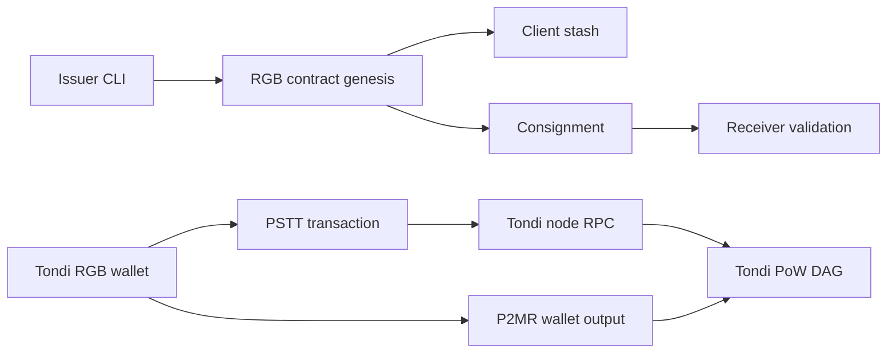
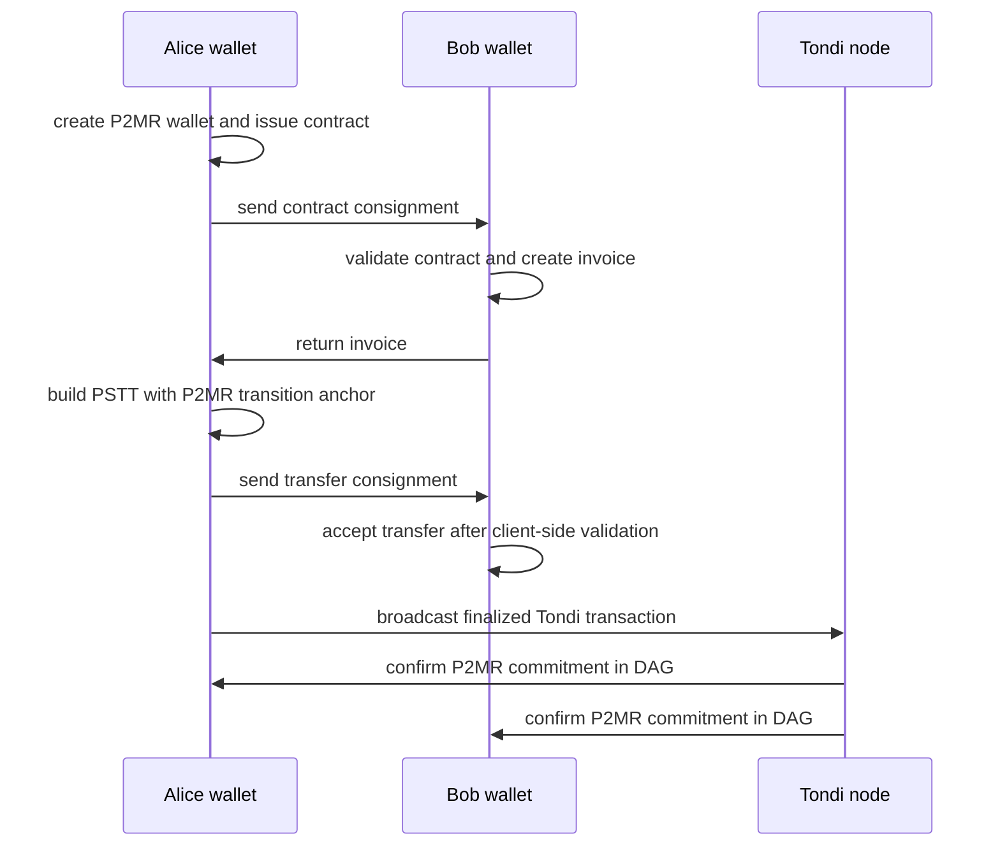

# RGB on Tondi

This workspace contains the Tondi-native RGB client-side validation stack. It keeps the RGB contract model while making Tondi P2MR outputs, Tondi RPC, and PSTT transaction handling the production path.

The active design goal is simple: contract state stays private with the client, while the public chain only carries a compact P2MR commitment in a spendable Tondi output.

## Architecture





## Main Components

- `rgb-core`: RGB consensus logic with Tondi seal bindings and P2MR publication checks.
- `rgb-std`: contract, invoice, stash, and consignment APIs for Tondi workflows.
- `rgb`: command-line wallet runtime and contract workflow tooling.
- `rgb-interfaces`: RGB20, RGB21, and related interface definitions.
- `bp-tondi-client`: Tondi RPC client used by resolver and devnet probes.
- `rgb-pstt` and `rgb-descriptors`: wallet transaction support for Tondi P2MR anchoring.

## Build And Test

```bash
cargo build --bin rgb
cargo check -p rgb-wallet --features resolver-tondi
cargo test -p rgb-core genesis_with_external_output -- --nocapture
cargo test -p rgb-std --test consignment -- --nocapture
./test_workflow_simple.sh
```

Devnet verification requires a Tondi node with RPC and the UTXO index enabled:

```bash
TONDI_DEVNET_RPC=127.0.0.1:26310 \
TONDI_DEVNET_ALLOW_UNSYNCED=1 \
bash scripts/devnet_p2mr_rgb_verify.sh
```

## Contract Workflow

The production workflow is documented in `TONDI_CONTRACT_WORKFLOWS.md` and automated by `test_full_workflow.sh`.

Required environment:

```bash
export ALICE_XPUB='<alice extended public key>'
export BOB_XPUB='<bob extended public key>'
export ISSUER_FILE='rgb/examples/RGB20-FNA.issuer'
export TONDI_RPC='127.0.0.1:26310'
export NETWORK='devnet'
```

Run:

```bash
./test_full_workflow.sh
```

The script creates Tondi P2MR wallets, imports an issuer, issues a contract, accepts the contract on the receiver side, builds an invoice, pays it with a PSTT, accepts the transfer, and finalizes or saves the public transaction depending on available signatures and node state.

## Repository Policy

- New wallet and resolver code must use Tondi P2MR publication paths.
- Runtime workflow docs and scripts must stay Tondi-native and English-only.
- Devnet checks should be run before merging changes that affect resolver, wallet, PSTT, or contract transfer behavior.
- Generated artifacts and large node snapshots should not be committed unless they are intentional fixtures.
