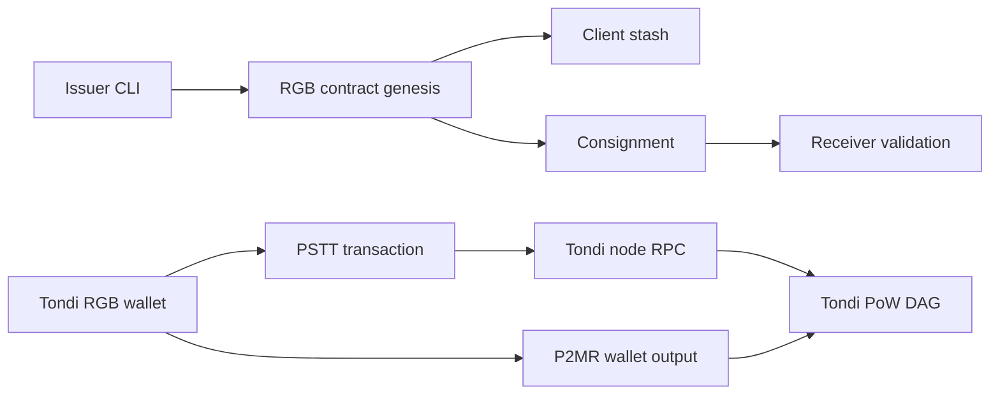
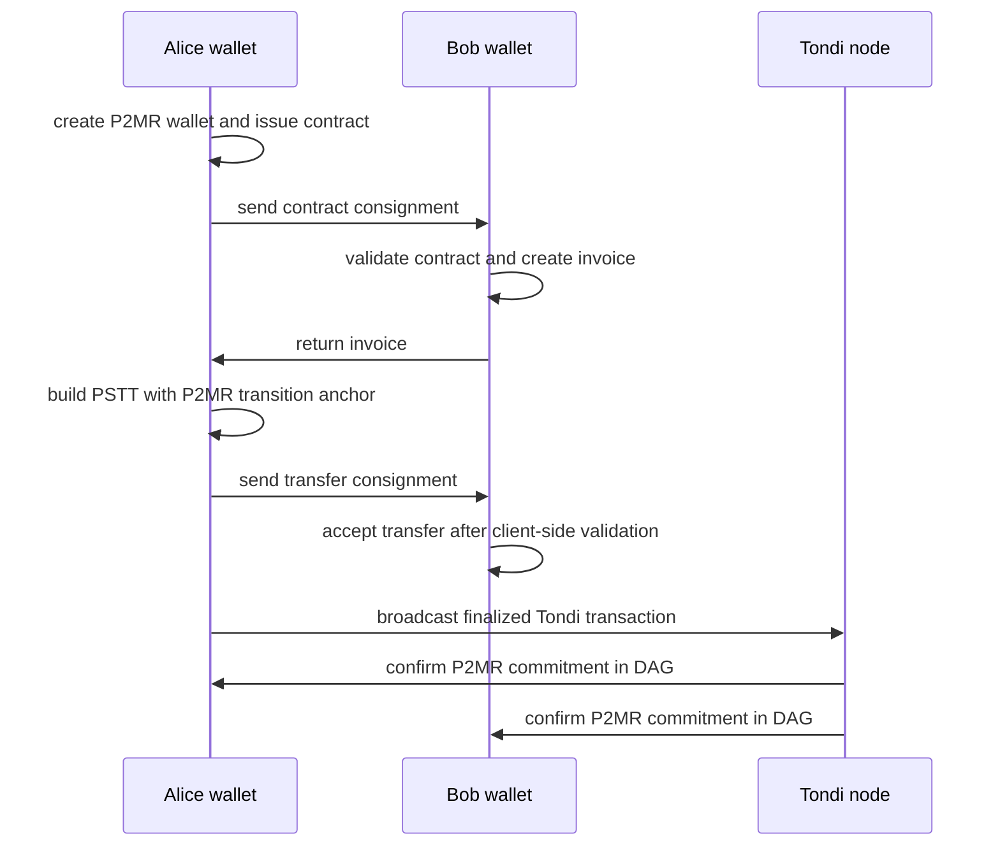

# RGB on Tondi

This workspace contains the Tondi-native RGB client-side validation stack. It keeps the RGB contract model while making Tondi P2MR outputs, Tondi RPC, and PSTT transaction handling the production path.

The active design goal is simple: contract state stays private with the client, while the public chain only carries a compact P2MR commitment in a spendable Tondi output.

## Architecture





## Main Components

- `rgb-core`: RGB consensus logic with Tondi seal bindings and P2MR publication checks.
- `rgb-std`: contract, invoice, stash, and consignment APIs for Tondi workflows.
- `rgb`: command-line wallet runtime and contract workflow tooling.
- `rgb-interfaces`: RGB20, RGB21, and related interface definitions.
- `bp-tondi-client`: Tondi RPC client used by resolver and devnet probes.
- `rgb-pstt` and `rgb-descriptors`: wallet transaction support for Tondi P2MR anchoring.

## Build And Test

```bash
cargo build --bin rgb
cargo check -p rgb-wallet --features resolver-tondi
cargo test -p rgb-wallet http_contract --bin rgb
cargo test -p rgb-wallet http_server --bin rgb --features resolver-tondi
node scripts/verify_frontend_http_contract.mjs
cargo test -p rgb-core genesis_with_external_output -- --nocapture
cargo test -p rgb-std --test consignment -- --nocapture
./test_workflow_simple.sh
```

`rgb/cli/src/http_contract.rs` defines the Rust DTOs and endpoint table for the
Avato wallet HTTP boundary. `scripts/verify_frontend_http_contract.mjs` checks
that this backend boundary still matches
`../avato-wallet-frontend/contracts/rgb-on-tondi-http-contract.json`.

The CLI also exposes an HTTP service for frontend integration:

```bash
TONDI_RPC=127.0.0.1:16310 \
cargo run -p rgb-wallet --features resolver-tondi -- \
  --network testnet2 serve-http --bind 127.0.0.1:8787
```

`POST /wallets` creates a Tondi P2MR descriptor wallet from a BIP39 recovery
phrase, `GET /wallet/profile` returns the active profile, `POST /wallet/sync`
refreshes live UTXOs through Tondi RPC, and `POST /wallet/p2mr-address` returns
the next P2MR funding address. The service also imports issuers, issues
contracts, accepts contract consignments, creates invoices, and prepares
transfer payments by writing real RGB consignment, PSTT, and bundle files.
Transfer accept validates a known-contract transfer consignment and records the
wallet-owned RGB state delta. Transfer finalisation signs matching Tondi P2MR
inputs from the unlocked local signer session, extracts the PSTT, and can
optionally broadcast the transaction. The service persists only an encrypted
wallet seed and clears decrypted signer material on lock; after a service
restart, unlock the wallet before finalising PSTT inputs.

Devnet verification requires a Tondi node with RPC and the UTXO index enabled:

```bash
TONDI_DEVNET_RPC=127.0.0.1:16310 \
TONDI_DEVNET_ALLOW_UNSYNCED=1 \
bash scripts/devnet_p2mr_rgb_verify.sh
```

For a self-contained local proof against a patched sibling Tondi checkout:

```bash
TONDI_REPO=../Tondi scripts/local_devnet_full_workflow.sh
```

This starts a local Tondi devnet with `--utxoindex`, funds Alice and Bob through
a real signed P2MR faucet transaction, mines the funding output, broadcasts the
RGB transfer, and requires `GetTransactionStatus` to report the final transfer
as `accepted`.

## Contract Workflow

The production workflow is documented in `TONDI_CONTRACT_WORKFLOWS.md` and automated by `test_full_workflow.sh`.

Required environment:

```bash
export ISSUER_FILE='<path-to-tondi-compatible-issuer.issuer>'
export TONDI_RPC='127.0.0.1:16310'
export NETWORK='testnet2'
```

Run:

```bash
AUTO_DEV_KEYS=1 WAIT_FOR_FUNDING=1 ./test_full_workflow.sh
```

The script creates Tondi P2MR wallets, imports an issuer, issues a contract, accepts the contract on the receiver side, builds an invoice, pays it with a PSTT, accepts the transfer, and finalizes or saves the public transaction depending on available signatures and node state.
Set `AUTO_BROADCAST=1` to broadcast the finalized Tondi-native transaction and verify that Tondi `GetTransactionStatus` reports `mempool` or `accepted`.
Set `REQUIRE_BROADCAST_ACCEPTED=1` when the run must wait until the broadcast
transaction is accepted into a block.
For reorg-sensitive checks, `GetTransactionStatus` distinguishes retained
known transactions that are no longer accepted as `removed`; pruned or
never-seen transactions remain `unknown`.
Wallet services should persist the last applied Tondi sink hash and replay
virtual-chain deltas with `TondiClient::replay_virtual_chain_from_checkpoint`.
The helper paginates `GetVirtualChainFromBlock` batches and falls back to the
node pruning point when the checkpoint is no longer retained; that fallback is
an explicit full-rescan signal for local RGB state.
On a fast local devnet, `MIN_CONFIRMATIONS=1` is suitable for this acceptance
proof; production and shared devnet runs should keep a higher confirmation
threshold unless the test explicitly owns the chain environment.

## Repository Policy

- New wallet and resolver code must use Tondi P2MR publication paths.
- Runtime workflow docs and scripts must stay Tondi-native and English-only.
- Devnet checks should be run before merging changes that affect resolver, wallet, PSTT, or contract transfer behavior.
- Generated artifacts and large node snapshots should not be committed unless they are intentional fixtures.
