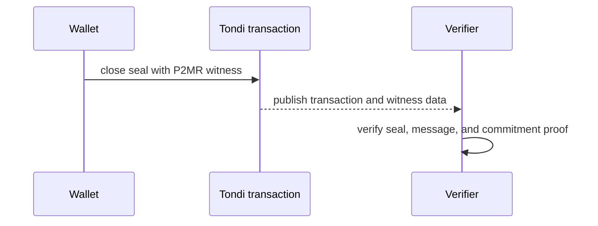

# Single-use Seals for Tondi

This crate defines the generic seal traits used by RGB-on-Tondi. A seal is a
unique publication point that can be closed over one message and then verified
independently by a client.

## Tondi Flow



The production RGB-on-Tondi path uses P2MR-backed witnesses over Tondi L1
outputs. Legacy host schemes are not part of the production workflow.

## Trait Shape

Seal implementations provide two core operations:

- close a seal over a message and produce a witness;
- verify that the witness closes that seal over the same message.

Implementations may expose additional helpers for locating the publication
medium, but verification must stay deterministic and side-effect free.

## Usage

```toml
single_use_seals = { workspace = true }
```

## Testing

```bash
cargo test -p single_use_seals
```

For new implementations, include tests for valid closure, wrong message,
wrong seal, missing witness data, and duplicate-publication handling.
