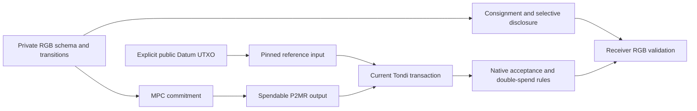

# RGB on current Tondi: private state with explicit public context

## Decision

Keep RGB client-side validation and P2MR single-use seals as the asset protocol.
Add bounded public Datum records and pinned read-only UTXO dependencies as an
explicit application facility. Use the current Tondi transaction version 1 and
RPC layout. Tondi is prelaunch: rebuild development stores and consignments
when encoding changes; do not add old-format importers or protocol fallbacks.

RGB contract IDs and native covenant IDs are different namespaces. A Tondi
covenant token is a public, consensus-validated asset. An RGB balance is private
client-side state. Neither namespace automatically represents, backs or bridges
the other.

## What the primitives actually provide

| Primitive | Authenticated capability | Boundary |
| --- | --- | --- |
| P2MR, SPK version 4 | Commit a spending program and an RGB MPC commitment; authorize the native output spend | Does not execute an RGB schema or prove private supply |
| Reference input | Read a specific UTXO that is live in the transaction acceptance view, without spending it | No fee value, ownership, signature execution, seal closure or mint authorization |
| Datum | Keep up to 4096 public bytes with an output, committed by native transaction ID, signing and UTXO commitment | No automatic meaning, replication after spend, confidentiality or permanent archive |
| Covenant envelope, SPK version 5 | Authenticate native lineage and constrain successor state with a script | Separate public asset path; not an automatic RGB verifier |

Together P2MR, references and Datum permit private RGB transfers to select
shared public policy, schema or metadata UTXOs; reusable public attestations;
and explicitly disclosed state digests. Multiple readers can reference the same
UTXO concurrently. Updating or deleting that UTXO consumes it; a pending reader
may then fail and must select its dependency again and re-sign.

They do not supply a general CKB/RISC-V execution environment, prove absence of
newer versions, enforce arbitrary AluVM rules in the Tondi VM, eliminate RGB
history/consignments, or give a trustless bridge to native covenant tokens.
An authenticated oracle publication still cannot prove real-world truth.

## Architecture

Default private transfers use P2MR outputs, no Datum and no public references.
Do not publish contract IDs, allocations, invoices, consignment locations,
blinding data or decryption material automatically. All ordinary outputs still
encode the current Datum absence byte. Private transfers are not identifiable
merely by using the new transaction version.

Public context is opt-in. `PublicDatum` uses the following bounded encoding:

| Field | Bytes |
| --- | ---: |
| `RGBD` | 4 |
| Format version `1` | 1 |
| Kind: schema 1, policy 2, metadata 3, state digest 4 | 1 |
| Explicitly public application bytes | 0–4090 |

This framing is an application convention, not a node asset type. The node
commits opaque Datum bytes. Applications define canonical content and publisher
trust. A policy record's existence does not make its policy execute on chain.
Names, icons and metadata do not authorize issuance.

`PublicReference` pins `(outpoint, script version, full script, exact Datum)`.
The current implementation supports public P2MR context UTXOs. The address used
for lookup is only a hint; every pinned field must match the live node response.
A copied Datum under another outpoint or script does not satisfy the pin.

The destination script alone does **not** authenticate a publisher: anyone can
fund an output to somebody else's P2MR address and attach arbitrary Datum.
`from_live` and `authenticate` authenticate record bytes against a selected pin,
not publication authority. The default application model must obtain that exact
pin from its authenticated issuer/schema or another explicit trust source.
An updatable registry additionally needs a publisher signature with a defined
domain/network/contract/version binding, or an authenticated consumed control
lineage whose program constrains Datum updates. Never select "the policy" merely
by scanning an issuer address. A copied signed record also needs version/outpoint
rules if the application wants one unique publication or revocation semantics.

## Construction and signing

1. Validate the contract and select consuming RGB seals and native fee inputs.
2. Resolve application-selected reference pins against the connected node's
   current UTXO view. Reject missing, changed, duplicated or overlapping inputs.
3. Append references before creating the final anchor/seal map and before any
   signature. Preserve consuming input indices. Add one authenticated previous
   output for every input, including references, to the signing context.
4. Create outputs and explicitly chosen public Datum, if any; build the MPC
   commitment in the P2MR leaf key. Keep private transitions off chain.
5. Budget native fees and carrier amounts using the complete transaction.
   Reference values are excluded from fee inputs; each reference incurs the
   node's base read mass of 500 plus its serialized UTXO size.
6. Sign consuming P2MR inputs with Default hash type, committing input kinds,
   outpoints, all previous output data and successor Datum. References are never
   signed or finalized as spenders.
7. Broadcast, require native acceptance/depth, validate the RGB consignment and
   apply wallet state. A pre-broadcast consignment is tentative until the native
   witness is accepted. Replay removed/added virtual-chain deltas after reorgs.

The native bridge preserves explicit SPK versions, signature operation counts,
reference kinds and absent/empty/present Datum through RPC, PSTT and extraction.
It rejects unsupported transaction versions and malformed UTXO responses.
The current BP sequence abstraction represents 0 through u32::MAX-1 and the
u64::MAX final sentinel. Other native sequences, including the ambiguous
u32::MAX value, are rejected explicitly rather than changing transaction identity.

## Historical verification and availability

A live ref query is appropriate when constructing a transaction. It is not a
historical proof: a dependency can legitimately be spent after the transfer.
Receivers must not reject an old valid transfer solely because its dependency
is no longer live now.

An application whose RGB rules depend on public context must bind the selected
pin in its schema/transition data and carry the context's creation transaction
(or an equivalent authenticated output proof) in its consignment extension.
The receiver checks the creation transaction ID and output bytes, the reference
input in the accepted anchor transaction, and its contract-specific publisher
and policy rules. Accepted native execution establishes liveness at acceptance;
that status still comes from the configured RGB resolver/node trust model.
`verify_witness` checks the data linkage; it is not a chain acceptance proof.

Raw RPC transaction data does not by itself prove acceptance. An untrusted node
requires authenticated inclusion/UTXO proofs beyond the current trusted-RPC
resolver. Pruning does not remove the need to retain RGB state history, context
witnesses, recovery secrets and consignments. Datum persists while its UTXO is
live, not forever after it is spent. No generic "latest policy" claim is made.

## Native public programs and application limits

Public fungible assets can use Tondi's fixed-supply/capped-issuance covenant
programs and generic Datum directly; they do not need RGB client-side supply
validation. Mint/control rights must be consumed, so competing mints conflict.
A reference to a control cannot replace that spend.

An application may create custom covenant scripts to require particular public
references or successor Datum. Its script must authenticate lineage, program
root, publisher and state transitions, and respect VM/read limits. This RGB
adapter does not claim support for arbitrary covenant outputs or a completed
native/RGB bridge. The existing fixed/capped token programs do not gain policy
semantics merely because Datum is attached.

## Implementation and evidence

- `bp-core/consensus`: current transaction ID, bounded Datum, kind-tagged inputs,
  current Borsh records and one shared native P2MR signing implementation.
- `bp-core/seals`: only consuming inputs can close a single-use seal.
- `bp-std/pstt`: native fields survive proprietary maps and extraction; references
  are excluded from fee input sums and require no spending finalization.
- `bp-tondi-client`: current node protobufs, strict RPC conversion, `PublicDatum`,
  `PublicReference::{resolve, authenticate, append_to, verify_witness}`.
- `rgb` resolver and CLI: preserve full native context and use the shared signer.
- `bp-core/consensus/tests/tondi_current.rs`: independent node-generated vectors
  for plain, present-empty, present and maximum-size Datum, with references.
- `scripts/local_devnet_full_workflow.sh`: isolated current-node acceptance of
  public context publication, two readers submitted before waiting, context
  consumption, stale-reference rejection, retained historical data linkage, and
  private RGB issuance/invoice/consignment/PSTT signing and broadcast.

The bundled `Test.issuer` is a development transport fixture with a no-op verifier;
this workflow does not certify a production asset schema's economic rules.
It is stored in the current format and loaded directly. The CLI never repairs
an incompatible issuer or substitutes its verifier at runtime.

Local validation on 2026-11-14: RGB workspace tests passed (356 passed,
41 ignored), all-target checking passed, and ordinary workspace Clippy completed
with existing warnings. Strict Clippy is blocked by existing lint findings in
the bundled `strict-encoding` code. Tondi core/mining tests passed (95 passed,
7 ignored), and Tondi workspace all-target Clippy passed with warnings denied.
The isolated devnet workflow completed with both public-context readers accepted
and the private transfer accepted; the receiver synchronized 100 test units.

The public-context APIs provide construction and verification primitives. They
are not automatically activated for every RGB schema, nor exposed as a complete
policy editor in the HTTP/UI product. New policy-aware schemas and consignment
extensions must implement the historical checks above before treating a public
record as an asset rule. No backwards decoder is added for old transactions or
retired typed output formats.
